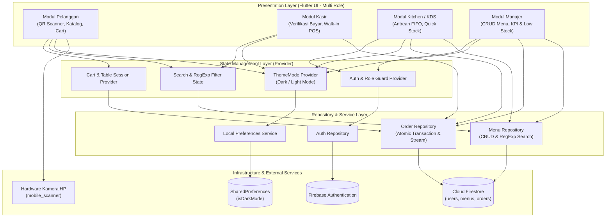
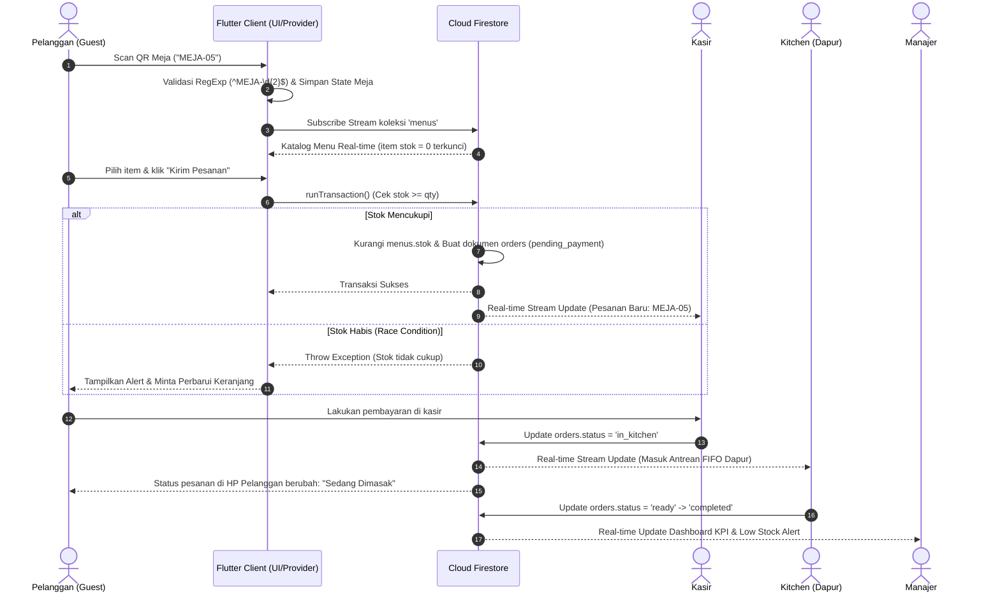

# System Architecture Document
**Nama Proyek:** Aplikasi Mobile POS, Kitchen Display System (KDS), dan Monitoring Rantai Pasok Internal Berbasis QR Table  
**Platform:** Mobile (Android / iOS)  
**Framework:** Flutter & Dart  

---

## 1. Tech Stack & Infrastruktur

### 1.1 Bahasa Pemrograman & Framework Frontend
* **Bahasa Pemrograman:** Dart (SDK versi $\ge 3.0.0$) dengan fitur *Null Safety* penuh.
* **UI Framework:** Flutter (Material Design 3) menggunakan arsitektur **Single-Codebase Multi-Role** (Pelanggan, Kasir, Dapur, dan Manajer dalam satu aplikasi).
* **State Management:** `provider` (`ChangeNotifierProvider` untuk *local/ephemeral state* seperti keranjang belanja dan tema, serta `StreamProvider` / `StreamBuilder` untuk *real-time state* dari database).

### 1.2 Backend-as-a-Service (BaaS) & Database
* ** Cloud Database:** **Firebase Cloud Firestore** (NoSQL Document Database) untuk penyimpanan data terpusat dengan dukungan sinkronisasi *real-time* (WebSockets) dan *Atomic Transactions* (`runTransaction`).
* **Layanan Autentikasi:** **Firebase Authentication** (`firebase_auth`) menggunakan metode Email & Password untuk staf internal (`kasir`, `kitchen`, `manager`), serta akses tanpa login (*Guest Session*) untuk pelanggan.
* **Penyimpanan Lokal (On-Device):** `shared_preferences` (Key-Value Storage) untuk menyimpan preferensi Mode Gelap (`isDarkMode`) sesuai spesifikasi `ThemeData` dan menyimpan sesi nomor meja aktif pelanggan.

### 1.3 Layanan & Library Pihak Ketiga
* **Pemindai QR Code:** `mobile_scanner` (menggunakan API kamera perangkat native Android CameraX / iOS AVFoundation untuk mendeteksi string QR meja secara *real-time*).
* **Lokalisasi & Pemformatan:** `intl` untuk pemformatan mata uang Rupiah (`Rp`) dan konversi zona waktu transaksi.
* **Pencarian & Filter Lokal:** Mesin ekspresi reguler bawaan Dart (`RegExp`) untuk pencocokan pola nama menu dan nomor meja secara instan di lapisan repositori.

---

## 2. System Architecture Diagram

### 2.1 High-Level Component Architecture (`graph TD`)
Diagram berikut menjelaskan lapisan arsitektur aplikasi Flutter dari antarmuka pengguna hingga layanan infrastruktur cloud dan penyimpanan lokal:



### 2.2 End-to-End Order Fulfillment & Atomic Stock Flow (`sequenceDiagram`)
Diagram urutan berikut menggambarkan aliran data *real-time* mulai dari pemindaian QR oleh pelanggan hingga pemantauan manajer:



---

## 3. Directory Structure

Struktur folder proyek menggunakan pendekatan **Layered Feature-Modular** yang memisahkan logika bisnis, repositori data, dan komponen UI agar mudah dikerjakan secara kolaboratif oleh anggota kelompok:

```text
pos_kds_qr_app/
├── android/
├── ios/
├── lib/
│   ├── main.dart                        # Entry point, inisialisasi Firebase & MultiProvider
│   ├── firebase_options.dart            # Konfigurasi auto-generated FlutterFire CLI
│   │
│   ├── core/                            # Konfigurasi global, konstanta, dan utilitas
│   │   ├── constants/
│   │   │   ├── app_constants.dart       # Konstanta status pesanan, role, dan koleksi Firestore
│   │   │   └── regex_patterns.dart      # Pola RegExp validasi QR meja & pencarian
│   │   ├── theme/
│   │   │   └── app_theme.dart           # Konfigurasi ThemeData (Light & Dark Mode)
│   │   └── utils/
│   │       ├── currency_formatter.dart  # Helper format Rupiah (intl)
│   │       └── validators.dart          # Fungsi validasi Form input stok, harga, & nama
│   │
│   ├── models/                          # Data Model & Serialization (fromMap / toMap)
│   │   ├── user_model.dart              # Representasi koleksi 'users'
│   │   ├── menu_model.dart              # Representasi koleksi 'menus' + helper isLowStock
│   │   ├── order_model.dart             # Representasi koleksi 'orders'
│   │   └── order_item_model.dart        # Representasi item di dalam array pesanan
│   │
│   ├── repositories/                    # Lapisan abstraksi komunikasi data (Data Access Layer)
│   │   ├── auth_repository.dart         # Login, Logout, & ambil data role dari Firestore
│   │   ├── menu_repository.dart         # Stream menu, CRUD stok, & filter pencarian RegExp
│   │   ├── order_repository.dart        # Atomic transaction order, rollback stok, & stream FIFO
│   │   └── theme_repository.dart        # Baca/tulis preferensi mode gelap ke SharedPreferences
│   │
│   ├── providers/                       # State Management (ChangeNotifier)
│   │   ├── auth_provider.dart           # State sesi user & routing berbasis role
│   │   ├── cart_provider.dart           # State nomor meja aktif, keranjang belanja, & kalkulasi total
│   │   ├── menu_filter_provider.dart    # State kata kunci pencarian RegExp & filter kategori
│   │   └── theme_provider.dart          # State aktif ThemeMode (Light/Dark)
│   │
│   ├── screens/                         # Halaman Antarmuka berdasarkan Aktor/Role
│   │   ├── auth/
│   │   │   ├── landing_screen.dart      # Pilihan masuk: "Pesan via QR" (Pelanggan) atau "Login Staf"
│   │   │   └── login_screen.dart        # Halaman login staf (Kasir, Kitchen, Manager)
│   │   ├── customer/
│   │   │   ├── qr_scanner_screen.dart   # Layar kamera pemindai QR meja (mobile_scanner)
│   │   │   ├── customer_menu_screen.dart# Katalog menu pelanggan + fitur cari RegExp
│   │   │   ├── cart_screen.dart         # Ringkasan keranjang & tombol checkout
│   │   │   └── order_status_screen.dart # Layar pantau status pesanan pelanggan real-time
│   │   ├── kasir/
│   │   │   ├── kasir_dashboard.dart     # Tab antrean 'pending_payment' & pembatalan pesanan
│   │   │   └── walkin_pos_screen.dart   # Input pesanan manual (Walk-in) oleh kasir
│   │   ├── kitchen/
│   │   │   ├── kds_queue_screen.dart    # Layar antrean produksi FIFO ('in_kitchen' & 'ready')
│   │   │   └── quick_stock_screen.dart  # Kontrol cepat ubah/nolkan stok menu dari dapur
│   │   └── manager/
│   │       ├── manager_dashboard.dart   # Ringkasan pendapatan, antrean aktif, & peringatan low stock
│   │       ├── menu_form_screen.dart    # Formulir tambah/edit menu & stok dengan validasi
│   │       └── order_history_screen.dart# Riwayat transaksi lengkap + filter RegExp nomor meja
│   │
│   └── widgets/                         # Komponen UI yang dapat digunakan kembali (Reusable)
│       ├── theme_toggle_button.dart     # Tombol switch Dark/Light mode di AppBar
│       ├── menu_card_widget.dart        # Kartu item menu dengan badge stok & indikator habis
│       ├── order_ticket_card.dart       # Kartu tiket pesanan untuk layar Kasir & Kitchen
│       └── empty_state_widget.dart      # Tampilan standar saat data kosong / tidak ditemukan
│
└── pubspec.yaml                         # Daftar dependensi paket Flutter
```

---

## 4. Data Flow & State Management

Sistem menerapkan pola **Unidirectional Data Flow (Aliran Data Satu Arah)** yang memisahkan tampilan UI dari logika mutasi data:

### 4.1 Alur Pembacaan Data Real-Time (*Reactive Read Flow*)
1. **Sumber Data:** Koleksi `menus` dan `orders` di Cloud Firestore memancarkan perubahan data melalui `snapshots()`.
2. **Transformasi Repositori:** `MenuRepository` dan `OrderRepository` mengubah `QuerySnapshot` mentah menjadi objek bertipe kuat (`List<MenuModel>` dan `List<OrderModel>`).
3. **Pemfilteran RegExp:** Jika pengguna mengetikkan kata kunci pada kolom pencarian, `MenuFilterProvider` menerapkan ekspresi reguler `RegExp(pattern, caseSensitive: false)` terhadap aliran data sebelum dikirim ke UI.
4. **Render UI:** Komponen `StreamBuilder` mendengarkan aliran data tersebut dan otomatis membangun ulang (*rebuild*) bagian widget yang berubah tanpa perlu muat ulang manual.

### 4.2 Alur Mutasi Data & Transaksi Stok (*Atomic Write Flow*)
1. **Aksi Pengguna:** Pelanggan menekan tombol **"Kirim Pesanan"** atau Kasir menekan **"Batalkan Pesanan"**.
2. **Validasi Lokal:** `CartProvider` atau `FormState` memvalidasi input di sisi klien (memastikan kuantitas $> 0$ dan format meja valid).
3. **Eksekusi Transaksi:** `OrderRepository` memanggil `FirebaseFirestore.instance.runTransaction()`.
   * Seluruh dokumen menu yang dipesan dibaca terlebih dahulu (`transaction.get()`).
   * Sistem memverifikasi kecukupan stok ($\text{stok\_aktual} \ge \text{qty\_pesan}$).
   * Jika valid, pembaruan `menus.stok` dan pembuatan dokumen `orders` dieksekusi dalam satu operasi atomik.
4. **Umpan Balik UI:** Jika transaksi berhasil, `CartProvider` mengosongkan keranjang dan mengarahkan pengguna ke layar status pesanan. Jika gagal (misalnya karena *race condition* stok habis), repositori melempar `Exception` yang ditangkap oleh UI untuk ditampilkan melalui `SnackBar`.

### 4.3 Alur Penyimpanan Preferensi Tema (*Local Persistence Flow*)
1. Pengguna menekan `ThemeToggleButton` pada `AppBar`.
2. `ThemeProvider` memperbarui *state* `ThemeMode` di memori dan memanggil `ThemeRepository.saveThemeMode(isDark)`.
3. `ThemeRepository` menyimpan nilai boolean ke `SharedPreferences` dengan kunci `'pref_dark_mode'`.
4. Root widget `MaterialApp` mendengarkan `ThemeProvider` melalui `Consumer<ThemeProvider>` dan mengganti `themeMode` secara instan di seluruh layar aplikasi.