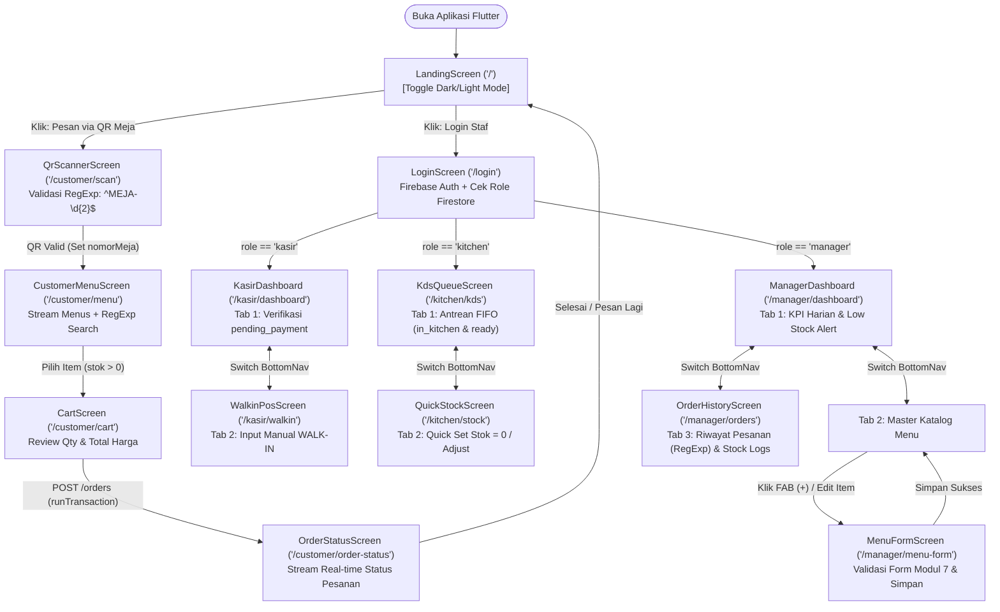

# UI/UX & Design System Specification (DESIGN.md)

**Nama Proyek:** Aplikasi Mobile POS, Kitchen Display System (KDS), dan Monitoring Rantai Pasok Internal Berbasis QR Table  
**Framework UI:** Flutter ($\ge 3.19.x$) — Material Design 3 (`useMaterial3: true`)  
**State & Theme Persistence:** `provider` + `shared_preferences` (`pref_dark_mode`)  
**Acuan Dokumen:** `PRD.md`, `ARCHITECTURE.md`, `schema.sql`, `API_SPEC.md`, `GEMINI.md`, dan `PLAN.md`

---

## 1. Design Direction & Design Tokens

### 1.1 Visual Style & Theme
* **Karakter Visual:** *Operational Efficiency & High-Contrast F&B Utility*. Antarmuka dirancang bersih, fungsional, dan memiliki kontras visual tinggi agar staf kasir serta koki dapur dapat memindai status pesanan dan indikator stok kritis dalam waktu kurang dari $1\text{ detik}$.
* **Dual-Theme First (Light & Dark Mode):**
  * **Light Mode (Default Pelanggan & Kasir):** Latar belakang hangat dan bersih (`#F8FAFC`) dengan aksen *Culinary Terracotta Orange* (`#EA580C`) yang menggugah selera dan memperjelas tombol aksi utama (*Call-to-Action*).
  * **Dark Mode (Optimal untuk Kitchen Display & Area Minim Cahaya):** Latar belakang *Deep Slate* (`#0F172A`) dan permukaan kartu (`#1E293B`) untuk mengurangi kelelahan mata (*eye strain*) dan pantulan cahaya di area dapur yang panas/terang. Diaktifkan secara instan melalui `ThemeProvider` dan disimpan di `SharedPreferences` dengan kunci `'pref_dark_mode'`.

### 1.2 Color Palette & Semantic Tokens

Seluruh warna didefinisikan di dalam `lib/core/theme/app_theme.dart` dan dipetakan ke `ColorScheme` Material 3:

| Token Semantik | Peran & Penggunaan UI | Light Mode (Hex / Flutter) | Dark Mode (Hex / Flutter) |
| :--- | :--- | :--- | :--- |
| **`primary`** | CTA Utama, AppBar Aktif, Tombol Checkout, Harga Menu | `#EA580C` (`0xFFEA580C`) | `#F97316` (`0xFFF97316`) |
| **`onPrimary`** | Teks & Ikon di atas warna `primary` | `#FFFFFF` (`0xFFFFFFFF`) | `#0F172A` (`0xFF0F172A`) |
| **`primaryContainer`** | Badge Nomor Meja, Chip Kategori Terpilih | `#FFEDD5` (`0xFFFFEDD5`) | `#431407` (`0xFF431407`) |
| **`secondary`** | Aksi Sekunder, Elemen Navigasi Kasir & Manajer | `#0F766E` (`0xFF0F766E`) | `#14B8A6` (`0xFF14B8A6`) |
| **`accent`** | Highlight Antrean Baru, Indikator Fokus | `#F59E0B` (`0xFFF59E0B`) | `#FBBF24` (`0xFFFBBF24`) |
| **`background`** | Warna Dasar Layar (`Scaffold.backgroundColor`) | `#F8FAFC` (`0xFFF8FAFC`) | `#0F172A` (`0xFF0F172A`) |
| **`surface`** | Latar Belakang `Card`, `Dialog`, `BottomSheet`, `AppBar` | `#FFFFFF` (`0xFFFFFFFF`) | `#1E293B` (`0xFF1E293B`) |
| **`surfaceVariant`** | Latar Belakang Input Field, Area Kosong, Header Tabel | `#F1F5F9` (`0xFFF1F5F9`) | `#334155` (`0xFF334155`) |
| **`border`** | Garis Pembatas `Card`, `Divider`, Outline Input | `#E2E8F0` (`0xFFE2E8F0`) | `#475569` (`0xFF475569`) |
| **`textPrimary`** | Judul Menu, Nomor Meja, Total Harga, Nama Staf | `#0F172A` (`0xFF0F172A`) | `#F8FAFC` (`0xFFF8FAFC`) |
| **`textSecondary`** | Kategori Menu, Sub-judul, Label Form | `#475569` (`0xFF475569`) | `#CBD5E1` (`0xFFCBD5E1`) |
| **`textMuted`** | Placeholder Input, Timestamp, Item Stok Habis | `#94A3B8` (`0xFF94A3B8`) | `#64748B` (`0xFF64748B`) |
| **`statusSuccess`** | Status `ready`, `completed`, Indikator Stok Aman | `#16A34A` (`0xFF16A34A`) | `#22C55E` (`0xFF22C55E`) |
| **`statusWarning`** | Status `pending_payment`, Peringatan *Low Stock* ($\text{stok} \le \text{batasMinimum}$) | `#D97706` (`0xFFD97706`) | `#F59E0B` (`0xFFF59E0B`) |
| **`statusError`** | Status `cancelled`, Stok Habis ($\text{stok} = 0$), Validasi Gagal | `#DC2626` (`0xFFDC2626`) | `#EF4444` (`0xFFEF4444`) |
| **`statusInfo`** | Status `in_kitchen` (Sedang Dimasak), Badge Walk-in | `#2563EB` (`0xFF2563EB`) | `#3B82F6` (`0xFF3B82F6`) |

### 1.3 Typography Scale
* **Font Utama (UI & Narasi):** `Roboto` (bawaan Material 3) atau `Inter` — keterbacaan tinggi pada layar ukuran kecil hingga tablet.
* **Font Monospace (Angka, Kode & Waktu):** `RobotoMono` — wajib digunakan pada **Nomor Meja** (`MEJA-05`), **Order ID** (`ord_20261116_001`), **Nominal Rupiah**, dan **Durasi Antrean** agar posisi digit sejajar secara vertikal (*tabular numerals*).

| Token Tipografi | Pemetaan `TextTheme` Flutter | Ukuran (`sp`) | `fontWeight` | `height` (Line-Height) | Penggunaan Utama |
| :--- | :--- | :--- | :--- | :--- | :--- |
| **`Heading 1`** | `headlineLarge` | $28\text{ sp}$ | `FontWeight.w700` (Bold) | $1.25$ | Judul Hero `LandingScreen`, Total Bayar Checkout |
| **`Heading 2`** | `headlineMedium` | $22\text{ sp}$ | `FontWeight.w700` (Bold) | $1.30$ | Angka KPI Manajer, Header Nomor Meja Tiket KDS |
| **`Heading 3`** | `titleLarge` | $18\text{ sp}$ | `FontWeight.w600` (SemiBold) | $1.35$ | Judul `AppBar`, Judul Modal/Dialog, Nama Bagian |
| **`Heading 4`** | `titleMedium` | $16\text{ sp}$ | `FontWeight.w600` (SemiBold) | $1.40$ | Nama Menu pada `MenuCardWidget`, Nomor Meja di Kasir |
| **`Body Large`** | `bodyLarge` | $15\text{ sp}$ | `FontWeight.w500` (Medium) | $1.45$ | Rincian Item Pesanan pada `OrderTicketCard`, Input Teks |
| **`Body Regular`** | `bodyMedium` | $14\text{ sp}$ | `FontWeight.w400` (Regular) | $1.50$ | Deskripsi Umum, Pesan `SnackBar`, Riwayat Log |
| **`Caption / Badge`** | `labelSmall` | $12\text{ sp}$ | `FontWeight.w600` (SemiBold) | $1.20$ | Teks `StatusBadge`, Label Sisa Stok, Timestamp |
| **`Button Text`** | `labelLarge` | $14\text{ sp}$ | `FontWeight.w600` (SemiBold) | $1.25$ | Label Tombol Utama & Sekunder (`letterSpacing: 0.3`) |

### 1.4 Spacing, Layout & Effects
* **Sistem Grid & Spacing ($4\text{ px}$ / $8\text{ px}$ Base Unit):**
  * `spaceXXS`: $4.0\text{ dp}$ (Jarak antar ikon dan teks di dalam badge)
  * `spaceXS`: $8.0\text{ dp}$ (Jarak antar elemen di dalam kartu, *chip spacing*)
  * `spaceSM`: $12.0\text{ dp}$ (Jarak vertikal antar item daftar/list)
  * `spaceMD`: $16.0\text{ dp}$ (Padding standar tepi layar `Scaffold` dan padding internal `Card`)
  * `spaceLG`: $24.0\text{ dp}$ (Jarak antar seksi di dalam Dashboard atau Form)
  * `spaceXL`: $32.0\text{ dp}$ (Padding atas/bawah untuk tampilan *Empty State* atau *Auth Card*)
* **Border Radius:**
  * `radiusSM`: $8.0\text{ dp}$ (Input field, tombol kecil, badge status)
  * `radiusMD`: $12.0\text{ dp}$ (`MenuCardWidget`, `OrderTicketCard`)
  * `radiusLG`: $16.0\text{ dp}$ (`BottomSheet`, `AlertDialog`, Kartu KPI Manajer)
  * `radiusFull`: $999.0\text{ dp}$ (`FilterChip` kategori, indikator bulat)
* **Elevation & Border Rules:**
  * Pada **Light Mode**: Gunakan `elevation: 1` dengan border tipis $1.0\text{ dp}$ berwarna `border` (`#E2E8F0`).
  * Pada **Dark Mode**: Gunakan `elevation: 0` dan wajib menyertakan `RoundedRectangleBorder(side: BorderSide(color: Color(0xFF334155), width: 1.0))` agar batas kartu tetap tegas di atas latar gelap.
* **Responsive Breakpoints (`LayoutBuilder` / `MediaQuery`):**
  * **Mobile Portrait ($< 600\text{ dp}$):** Tampilan daftar $1\text{ kolom}$ (`ListView`) untuk katalog menu dan antrean pesanan.
  * **Tablet / KDS Landscape ($\ge 600\text{ dp}$ dan $< 1024\text{ dp}$):** Tampilan grid $2\text{ kolom}$ (`GridView.FixedCrossAxisCount(crossAxisCount: 2)`) untuk katalog menu dan tiket antrean KDS dapur. Form login/menu dibatasi maksimum `maxWidth: 480.0`.
  * **Desktop / Wide Tablet ($\ge 1024\text{ dp}$):** Tampilan grid $3\text{ kolom}$ untuk antrean KDS dapur dan dashboard manajer.

---

## 2. Information Architecture & Routing Map

### 2.1 Navigation Pattern per User Role
Aplikasi menggunakan pola navigasi yang terisolasi berdasarkan peran pengguna (*Role-Based Navigation Guard*):

1. **Unauthenticated / Landing (`LandingScreen`):**
   * Tidak memiliki *Bottom Navigation Bar*. Hanya memiliki `AppBar` transparan dengan `ThemeToggleButton` di pojok kanan atas dan dua tombol kartu utama di tengah layar.
2. **Customer / Guest (`role: null`, sesi `nomorMeja` aktif):**
   * Menggunakan **Linear Stack Navigation**.
   * `CustomerMenuScreen` memiliki *Sticky Bottom Cart Bar* yang melayang di bagian bawah layar jika $\text{jumlah item di keranjang} \ge 1$.
   * Setelah pesanan dikirim, navigasi menggunakan `Navigator.pushReplacementNamed` menuju `OrderStatusScreen` agar pelanggan tidak kembali ke keranjang lama dengan tombol *Back*.
3. **Kasir (`role: 'kasir'`):**
   * Menggunakan `Scaffold` dengan `BottomNavigationBar` ($2\text{ destinasi}$):
     * Tab 1: **Antrean Bayar** (`pending_payment`) — dilengkapi *badge counter* jumlah pesanan yang menunggu verifikasi.
     * Tab 2: **POS Walk-in** — katalog menu untuk input pesanan langsung di kasir (`nomorMeja: 'WALK-IN'`).
   * `AppBar` kanan memuat `ThemeToggleButton` dan tombol `Logout`.
4. **Kitchen / Dapur (`role: 'kitchen'`):**
   * Menggunakan `Scaffold` dengan `BottomNavigationBar` ($2\text{ destinasi}$):
     * Tab 1: **Antrean KDS (FIFO)** — menampilkan tiket berstatus `in_kitchen` dan `ready` terurut dari `waktuPesan` terlama.
     * Tab 2: **Stok Cepat** — daftar seluruh menu dengan tombol *quick action* (`Habis / Set 0`, `-1`, `+1`, `Edit Stok`).
   * `AppBar` kanan memuat `ThemeToggleButton` (sangat krusial untuk dapur) dan tombol `Logout`.
5. **Manager (`role: 'manager'`):**
   * Menggunakan `Scaffold` dengan `BottomNavigationBar` ($3\text{ destinasi}$):
     * Tab 1: **Dashboard & KPI** — metrik pendapatan, antrean aktif, dan daftar peringatan *Low Stock*.
     * Tab 2: **Master Menu** — daftar katalog menu beserta `FloatingActionButton` (`+ Tambah Menu`) yang membuka `MenuFormScreen`.
     * Tab 3: **Riwayat & Log** — sub-tab untuk *Riwayat Transaksi Pesanan* (dengan filter `RegExp` nomor meja) dan *Audit Log Stok* (`stock_logs`).

### 2.2 Route Table

| Nama Route (`AppRoutes`) | Path String | Widget Layar (`lib/screens/...`) | Parameter / Arguments | Proteksi Auth & Role Guard |
| :--- | :--- | :--- | :--- | :--- |
| `landing` | `'/'` | `LandingScreen` | Tidak ada | Public (Titik masuk awal aplikasi) |
| `login` | `'/login'` | `LoginScreen` | Tidak ada | Public (Redirect ke dashboard jika sudah login) |
| `qrScanner` | `'/customer/scan'` | `QrScannerScreen` | Tidak ada | Public / Guest |
| `customerMenu` | `'/customer/menu'` | `CustomerMenuScreen` | Wajib: `CartProvider.nomorMeja != null` | Guest dengan sesi nomor meja valid (`^MEJA-\d{2}$`) |
| `customerCart` | `'/customer/cart'` | `CartScreen` | Wajib: `CartProvider.items.isNotEmpty` | Guest (`MEJA-XX`) atau Role `'kasir'` (`WALK-IN`) |
| `orderStatus` | `'/customer/order-status'` | `OrderStatusScreen` | `String orderId` | Public / Guest |
| `kasirHome` | `'/kasir/dashboard'` | `KasirDashboard` | `int initialTab` (default: `0`) | Auth Wajib: `user.role == 'kasir'` |
| `walkinPos` | `'/kasir/walkin'` | `WalkinPosScreen` | Tidak ada (otomatis set `'WALK-IN'`) | Auth Wajib: `user.role == 'kasir'` |
| `kitchenHome` | `'/kitchen/kds'` | `KdsQueueScreen` | Tidak ada | Auth Wajib: `user.role == 'kitchen'` |
| `quickStock` | `'/kitchen/stock'` | `QuickStockScreen` | Tidak ada | Auth Wajib: `user.role == 'kitchen'` |
| `managerHome` | `'/manager/dashboard'` | `ManagerDashboard` | `int initialTab` (default: `0`) | Auth Wajib: `user.role == 'manager'` |
| `menuForm` | `'/manager/menu-form'` | `MenuFormScreen` | `MenuModel? existingMenu` (`null` = tambah, terisi = edit) | Auth Wajib: `user.role == 'manager'` |
| `orderHistory` | `'/manager/orders'` | `OrderHistoryScreen` | Tidak ada | Auth Wajib: `user.role == 'manager'` |

### 2.3 Screen Flow Diagram



---

## 3. Reusable UI Component Library

Seluruh komponen ditempatkan di `lib/widgets/` sebagai `StatelessWidget` atau `StatefulWidget` modular dengan `const` constructor.

### 3.1 `ThemeToggleButton` (`lib/widgets/theme_toggle_button.dart`)
* **Fungsi:** Tombol ikon di `AppBar` untuk mengganti mode terang/gelap dan menyimpannya ke `SharedPreferences`.
* **Props / Parameter:** `bool showLabel = false`.
* **Varian Visual & State:**
  * `Default (Light Mode)`: Menampilkan `Icon(Icons.dark_mode_outlined)` berwarna `textPrimary` dengan tooltip `"Aktifkan Mode Gelap"`.
  * `Default (Dark Mode)`: Menampilkan `Icon(Icons.light_mode_rounded)` berwarna `accent` (`#FBBF24`) dengan tooltip `"Aktifkan Mode Terang"`.
  * `Pressed`: Efek *ripple* `InkWell` melingkar dengan animasi rotasi halus `AnimatedSwitcher` ($200\text{ ms}$).

### 3.2 `MenuCardWidget` (`lib/widgets/menu_card_widget.dart`)
* **Fungsi:** Kartu item katalog makanan/minuman yang digunakan di layar Pelanggan, POS Walk-in Kasir, dan Master Menu Manajer.
* **Props / Parameter:**
  * `required MenuModel menu`
  * `required int currentQtyInCart` (default `0` untuk tampilan Manajer)
  * `required VoidCallback? onIncrement`
  * `required VoidCallback? onDecrement`
  * `VoidCallback? onEditTap` (khusus tampilan Manajer)
  * `bool isManagerView = false`
* **Varian Visual & State:**
  * `Default (Stok Aman: stok > batasMinimum)`: Kartu berlatar `surface`, menampilkan nama menu (`Heading 4`), chip kategori, harga dalam format Rupiah (`Rp 25.000`), badge hijau `"Stok: 12"`, dan tombol `+ Tambah` berwarna `primary`.
  * `Warning (Low Stock: 0 < stok <= batasMinimum)`: Badge stok berubah menjadi warna `statusWarning` (`#D97706`) dengan teks `"Sisa 3 porsi!"`.
  * `Selected in Cart (currentQtyInCart > 0)`: Border kartu berubah menjadi `primary` ($1.5\text{ dp}$), tombol `+ Tambah` berubah menjadi kontrol *stepper* `[-] [qty] [+]`. Tombol `[+]` otomatis terkunci jika `currentQtyInCart == menu.stok`.
  * `Disabled / Out of Stock (stok == 0)`: Seluruh kartu diberi opasitas $0.6$, badge stok berwarna `statusError` (`#DC2626`) bertuliskan `"STOK HABIS"`, dan tombol tambah dinonaktifkan (`onIncrement: null`).

### 3.3 `OrderTicketCard` (`lib/widgets/order_ticket_card.dart`)
* **Fungsi:** Kartu tiket pesanan standar untuk layar verifikasi Kasir, layar antrean KDS Dapur, dan layar Riwayat Manajer.
* **Props / Parameter:**
  * `required OrderModel order`
  * `required String viewerRole` (`'kasir'`, `'kitchen'`, `'manager'`)
  * `VoidCallback? onPrimaryAction` (Konfirmasi Bayar / Siap Diantar / Selesai)
  * `VoidCallback? onSecondaryAction` (Batalkan Pesanan untuk Kasir)
  * `bool isLoading = false`
* **Varian Visual & State:**
  * `Header Tiket`: Menampilkan badge besar `nomorMeja` (`MEJA-05` atau `WALK-IN` dengan font monospace), ID singkat pesanan (`#001`), waktu pesan (`13:10 WIB`), dan `StatusBadge`.
  * `Body Tiket`: Daftar item (`2x Nasi Goreng Spesial`) beserta catatan subtotal jika dilihat oleh Kasir/Manajer. Pada mode `viewerRole == 'kitchen'`, harga disembunyikan dan ukuran font kuantitas (`2x`) diperbesar menjadi $18\text{ sp}$ Bold agar terbaca dari jarak jauh.
  * `Footer Action (Kasir - pending_payment)`: Menampilkan total tagihan Rupiah beserta 2 tombol berdampingan: tombol outline merah `"Batalkan"` dan tombol penuh hijau/oranye `"Konfirmasi Bayar"`.
  * `Footer Action (Kitchen - in_kitchen)`: Menampilkan tombol lebar penuh berwarna `statusInfo` (`#2563EB`) bertuliskan `"Tandai Siap Diantar (Ready)"`.
  * `Footer Action (Kitchen - ready)`: Menampilkan tombol lebar penuh berwarna `statusSuccess` (`#16A34A`) bertuliskan `"Selesaikan Pesanan (Completed)"`.
  * `Loading State`: Saat transaksi perubahan status berlangsung, tombol aksi menampilkan `SizedBox(width: 18, height: 18, child: CircularProgressIndicator(strokeWidth: 2))` dan menonaktifkan klik ulang.

### 3.4 `StatusBadge` (`lib/widgets/status_badge.dart`)
* **Fungsi:** Komponen label kapsul untuk menampilkan status siklus hidup pesanan secara konsisten.
* **Props / Parameter:** `required String status`.
* **Pemetaan Varian Visual:**
  * `'pending_payment'` $\rightarrow$ Latar `#FEF3C7`, Teks `#B45309`, Ikon `Icons.payments_outlined`, Label: `"Menunggu Bayar"`.
  * `'in_kitchen'` $\rightarrow$ Latar `#DBEAFE`, Teks `#1D4ED8`, Ikon `Icons.soup_kitchen_outlined`, Label: `"Sedang Dimasak"`.
  * `'ready'` $\rightarrow$ Latar `#DCFCE7`, Teks `#15803D`, Ikon `Icons.room_service_outlined`, Label: `"Siap Diantar"`.
  * `'completed'` $\rightarrow$ Latar `#F1F5F9`, Teks `#334155`, Ikon `Icons.check_circle_outline`, Label: `"Selesai"`.
  * `'cancelled'` $\rightarrow$ Latar `#FEE2E2`, Teks `#B91C1C`, Ikon `Icons.cancel_outlined`, Label: `"Dibatalkan"`.

### 3.5 `SearchRegExpBar` & `CategoryFilterChips`
* **Fungsi:** Komponen input pencarian instan berbasis `RegExp` (memenuhi tugas praktikum poin 2) dan penyaring kategori.
* **Props / Parameter:**
  * `required ValueChanged<String> onSearchChanged`
  * `required String hintText`
  * `String? selectedCategory`
  * `ValueChanged<String?>? onCategorySelected`
* **Varian Visual & State:**
  * `Default`: `TextField` dengan `prefixIcon: Icon(Icons.search)` dan border `radiusSM`.
  * `Focused`: Border berubah menjadi warna `primary` ($2.0\text{ dp}$).
  * `Filled (Query tidak kosong)`: Menampilkan `suffixIcon: IconButton(icon: Icon(Icons.clear))` untuk mereset pencarian `RegExp` dalam satu ketukan.
  * `Invalid RegExp Input`: Jika pengguna mengetik karakter regex mentah yang belum lengkap (misal `[`), repositori menangkap `FormatException` dan mengembalikan fallback pencocokan string literal (`RegExp.escape(query)`) sehingga UI tidak pernah menampilkan layar error.

### 3.6 `EmptyStateWidget` (`lib/widgets/empty_state_widget.dart`)
* **Fungsi:** Tampilan standar ketika koleksi kosong atau filter pencarian `RegExp` tidak menemukan hasil.
* **Props / Parameter:**
  * `required IconData icon`
  * `required String title`
  * `required String subtitle`
  * `String? actionLabel`
  * `VoidCallback? onActionPressed`

---

## 4. Screen-by-Screen / Page Specifications

### 4.1 `LandingScreen` (`lib/screens/auth/landing_screen.dart`)
* **Layout & Component Hierarchy:**
  * `AppBar`: Judul aplikasi singkat di kiri, `ThemeToggleButton` di kanan.
  * `Body (Centered Column, maxWidth: 480)`:
    1. Ilustrasi/Ikon utama restoran & rantai pasok (`Icons.qr_code_scanner_rounded`, ukuran $72\text{ dp}$, warna `primary`).
    2. Judul Aplikasi (`Heading 1`) dan sub-judul deskripsi singkat aliran *QR Table to Kitchen*.
    3. **Kartu CTA 1 (Utama - Pelanggan):** Tombol kartu besar berwarna `primary` dengan ikon kamera, judul `"Pesan Mandiri via QR Meja"`, dan sub-teks `"Scan kode QR di meja Anda tanpa perlu login"`.
    4. **Kartu CTA 2 (Sekunder - Staf):** Tombol kartu ber-outline dengan ikon kunci/staf, judul `"Portal Staf Operasional"`, dan sub-teks `"Login untuk Kasir, Kitchen (KDS), dan Manajer"`.
* **Data Binding & API Mapping:** Membaca `ThemeProvider.isDarkMode` (`shared_preferences`) dan `AuthProvider.currentUser`.
* **Interactive Behavior:**
  * Klik Kartu CTA 1 $\rightarrow$ Navigasi ke `/customer/scan` (`QrScannerScreen`).
  * Klik Kartu CTA 2 $\rightarrow$ Jika `AuthProvider.currentUser != null`, langsung *redirect* ke dashboard sesuai `role`; jika `null`, navigasi ke `/login`.
* **Strict UI Guardrails:** Dilarang menampilkan daftar menu atau data internal restoran di layar ini sebelum pengguna memindai QR meja atau login sebagai staf.

### 4.2 `LoginScreen` (`lib/screens/auth/login_screen.dart`)
* **Layout & Component Hierarchy:**
  * `AppBar`: Tombol *Back* ke `LandingScreen`, judul `"Login Staf Operasional"`, dan `ThemeToggleButton`.
  * `Body (SingleChildScrollView -> Form)`:
    1. Header informasi peran (`Kasir • Kitchen • Manager`).
    2. `TextFormField` Email (`keyboardType: TextInputType.emailAddress`, `textInputAction: TextInputAction.next`).
    3. `TextFormField` Password (`obscureText: true` dengan tombol ikon mata *show/hide password*).
    4. Tombol penuh `"Masuk ke Sistem"` (`PrimaryActionButton`).
* **Data Binding & API Mapping:** Memanggil `AuthProvider.login(email, password)` yang mengeksekusi `AuthRepository.signInWithEmailPassword()` (setara `POST /api/v1/auth/login` dan `GET /api/v1/auth/me`).
* **Interactive Behavior & Form Validation:**
  * Email wajib mengandung `@` dan tidak boleh kosong. Password minimal $6\text{ karakter}$.
  * Saat tombol ditekan, tombol berubah ke *Loading State*. Jika kredensial salah, tampilkan `SnackBar` merah (`statusError`). Jika berhasil, arahkan dengan `Navigator.pushNamedAndRemoveUntil` ke `/kasir/dashboard`, `/kitchen/kds`, atau `/manager/dashboard` sesuai `user.role`.
* **Strict UI Guardrails:** Tidak boleh ada fitur *"Registrasi Staf Mandiri"* untuk publik; pembuatan akun staf dikelola terpusat oleh administrator/seed data.

### 4.3 `QrScannerScreen` (`lib/screens/customer/qr_scanner_screen.dart`)
* **Layout & Component Hierarchy:**
  * `AppBar`: Tombol *Back*, judul `"Scan QR Nomor Meja"`, tombol *Switch Camera* & *Torch/Flash*.
  * `Body (Stack)`:
    1. Layer 1: `MobileScanner` (tampilan kamera *full-screen*).
    2. Layer 2: *Scanner Overlay* berupa kotak bidik tengah ($250 \times 250\text{ dp}$) dengan border sudut berwarna `primary`.
    3. Layer 3 (Bagian Bawah): Panel instruksi `"Arahkan kamera ke kode QR pada meja Anda (Contoh: MEJA-01 s/d MEJA-99)"` beserta tombol *fallback* simulasi/input kode meja untuk pengujian di emulator yang tidak memiliki kamera fisik.
* **Data Binding & API Mapping:** Memanggil `AuthRepository.validateQrTable(rawValue)` (setara `POST /api/v1/auth/validate-qr`) dan menyimpan hasilnya ke `CartProvider.setNomorMeja(nomorMeja)`.
* **Interactive Behavior & Validation:**
  * String hasil pindaian divalidasi terhadap `RegExp(r'^MEJA-\d{2}$')`.
  * Jika cocok (misal `"MEJA-05"`), hentikan kamera (`controller.stop()`), simpan ke `CartProvider`, dan navigasi `pushReplacementNamed` ke `/customer/menu`.
  * Jika tidak cocok (misal memindai QR URL), tampilkan `SnackBar` peringatan `"Kode QR meja tidak valid"` dengan *debounce* $2\text{ detik}$ agar tidak membanjiri layar dengan notifikasi berulang.
* **Strict UI Guardrails:** Hanya menerima format `MEJA-01` s/d `MEJA-99`. Pelanggan tidak diizinkan memilih mode `'WALK-IN'` dari layar ini.

### 4.4 `CustomerMenuScreen` (`lib/screens/customer/customer_menu_screen.dart`)
* **Layout & Component Hierarchy:**
  * `AppBar`: Badge identitas `"Meja: MEJA-05"` di kiri, tombol ganti meja, dan `ThemeToggleButton` di kanan.
  * `Body (Column)`:
    1. Header Pencarian: `SearchRegExpBar` (`hintText: "Cari nama makanan/minuman..."`) dan baris horizontal `CategoryFilterChips` (`Semua`, `Makanan`, `Minuman`, `Snack`).
    2. `Expanded`: `StreamBuilder<List<MenuModel>>` yang merender daftar `MenuCardWidget`.
  * `BottomNavigationBar (Conditional Sticky Bar)`: Muncul jika `CartProvider.totalItems > 0`, menampilkan ringkasan `"3 Item | Rp 68.000"` dan tombol `"Lihat Keranjang"`.
* **Data Binding & API Mapping:** Berlangganan *real-time stream* `MenuRepository.watchMenus()` dan menyaring hasilnya melalui `MenuFilterProvider` menggunakan `RegExp(query, caseSensitive: false)` (setara `GET /api/v1/menus?search=...&kategori=...`).
* **Interactive Behavior & Validation:**
  * Menekan tombol `[+]` pada `MenuCardWidget` menambah kuantitas di `CartProvider` selama $\text{qty} < \text{menu.stok}$.
  * Jika staf dapur mengubah stok menu menjadi $0$ saat pelanggan sedang melihat layar ini, `StreamBuilder` otomatis memperbarui kartu tersebut menjadi *Disabled / Stok Habis*.
* **Strict UI Guardrails:** Pelanggan tidak dapat melihat jumlah `batasMinimum` internal atau mengedit data menu.

### 4.5 `CartScreen` (`lib/screens/customer/cart_screen.dart`)
* **Layout & Component Hierarchy:**
  * `AppBar`: Tombol *Back*, judul `"Keranjang Pesanan"`, dan tombol `"Kosongkan"` di kanan.
  * `Body (Column)`:
    1. Banner Info Meja: Menampilkan nomor meja aktif (`MEJA-05` atau `WALK-IN`).
    2. `Expanded`: `ListView.separated` berisi daftar item di keranjang (`namaMenuSnapshot`, harga satuan, kontrol *stepper* `[-] [qty] [+]`, dan subtotal per item).
    3. `Summary Footer Card`: Menampilkan Total Item, Total Harga ($\sum (\text{harga}_i \times \text{qty}_i)$), dan tombol utama `"Kirim Pesanan Sekarang"`.
* **Data Binding & API Mapping:** Mengeksekusi `CartProvider.submitOrder()` yang memanggil `OrderRepository.createOrderWithStockTransaction()` menggunakan `FirebaseFirestore.instance.runTransaction()` (setara `POST /api/v1/orders`).
* **Interactive Behavior & Form Validation:**
  * Validasi keranjang tidak kosong ($\text{items.length} \ge 1$) dan setiap item memenuhi $1 \le \text{qty} \le \text{stok}$.
  * Jika transaksi atomik gagal karena *race condition* (meja lain baru saja menghabiskan stok item tersebut), tampilkan `AlertDialog` informatif yang menyebutkan nama menu yang habis dan minta pengguna menyesuaikan keranjang.
  * Jika sukses: Untuk pelanggan QR, arahkan ke `/customer/order-status` dengan argumen `orderId`. Untuk Kasir (`WALK-IN`), kembali ke dashboard kasir dan tampilkan `SnackBar` sukses.
* **Strict UI Guardrails:** Harga dan nama item yang dikirim wajib disimpan sebagai *snapshot* (`namaMenuSnapshot`, `hargaSatuanSnapshot`) di dalam array `items`.

### 4.6 `OrderStatusScreen` (`lib/screens/customer/order_status_screen.dart`)
* **Layout & Component Hierarchy:**
  * `AppBar`: Judul `"Status Pesanan Anda"`, `ThemeToggleButton`.
  * `Body (StreamBuilder<OrderModel>)`:
    1. Kartu Header Status: Menampilkan Nomor Meja (`MEJA-05`), `orderId`, dan `StatusBadge` berukuran besar.
    2. **Vertical Order Stepper ($4\text{ Tahap}$):**
       * Tahap 1: **Menunggu Pembayaran** (`pending_payment`) — *"Silakan menuju kasir dan sebutkan nomor meja Anda untuk membayar."*
       * Tahap 2: **Sedang Diproses Dapur** (`in_kitchen`) — *"Pembayaran diterima! Pesanan Anda sedang dimasak oleh dapur."*
       * Tahap 3: **Siap Diantar** (`ready`) — *"Hidangan sudah siap dan sedang diantar ke meja Anda."*
       * Tahap 4: **Selesai** (`completed`) — *"Selamat menikmati hidangan Anda!"*
       *(Jika status berubah menjadi `cancelled`, tampilkan banner merah bahwa pesanan telah dibatalkan oleh kasir).*
    3. Kartu Rincian Item & Total Tagihan (`read-only`).
    4. Tombol bawah: `"Buat Pesanan Baru"` (mereset keranjang dan kembali ke katalog menu).
* **Data Binding & API Mapping:** Berlangganan `OrderRepository.watchOrderById(orderId)` (setara `GET /api/v1/orders/:order_id`).
* **Strict UI Guardrails:** Layar ini sepenuhnya *read-only*; pelanggan tidak dapat mengubah status atau membatalkan pesanan sendiri tanpa melalui kasir.

### 4.7 `KasirDashboard` & `WalkinPosScreen` (`lib/screens/kasir/...`)
* **Layout & Component Hierarchy:**
  * `AppBar`: Judul `"POS Kasir — [Nama Staf]"`, kolom pencarian cepat nomor meja (`RegExp`), `ThemeToggleButton`, dan tombol `Logout`.
  * **Tab 1 (`KasirDashboard` - Antrean Verifikasi):**
    * Filter chip status cepat: `"Menunggu Bayar (pending_payment)"` (default) dan `"Sedang Diproses (in_kitchen & ready)"`.
    * Daftar `OrderTicketCard` yang menampilkan pesanan masuk secara *real-time*.
  * **Tab 2 (`WalkinPosScreen` - Input Pesanan Langsung):**
    * Menggunakan komponen katalog `MenuCardWidget` dan `SearchRegExpBar` dengan identitas meja terkunci pada `'WALK-IN'` dan opsi `directPay: true` (pesanan langsung berstatus `'in_kitchen'` saat disimpan).
* **Data Binding & API Mapping:**
  * Membaca stream `OrderRepository.watchOrdersByStatus(['pending_payment'])` (`GET /api/v1/orders?status=pending_payment`).
  * Tombol **"Konfirmasi Bayar"** memanggil `OrderRepository.verifyPayment(orderId, kasirUid)` (`PATCH /api/v1/orders/:order_id/verify-payment`).
  * Tombol **"Batalkan"** memanggil dialog konfirmasi lalu mengeksekusi `OrderRepository.cancelOrderWithStockRollback(orderId)` (`PATCH /api/v1/orders/:order_id/cancel`).
* **Interactive Behavior & Validation:**
  * Hanya pesanan berstatus `'pending_payment'` yang menampilkan tombol **"Konfirmasi Bayar"** dan **"Batalkan"**.
  * Pembatalan pesanan wajib menampilkan `AlertDialog` konfirmasi karena akan mengembalikan (`increment`) stok item ke koleksi `menus`.
* **Strict UI Guardrails:** Kasir tidak memiliki akses untuk mengubah status dapur (`ready` / `completed`) atau mengedit harga master menu.

### 4.8 `KdsQueueScreen` & `QuickStockScreen` (`lib/screens/kitchen/...`)
* **Layout & Component Hierarchy:**
  * `AppBar`: Judul `"Kitchen Display System (KDS)"`, badge jumlah antrean aktif, `ThemeToggleButton`, dan `Logout`.
  * **Tab 1 (`KdsQueueScreen` - Antrean Produksi FIFO):**
    * Banner informasi pengurutan: `"Urutan Antrean: FIFO (Pesanan Terlama di Atas)"`.
    * Grid/List `OrderTicketCard` untuk pesanan berstatus `'in_kitchen'` dan `'ready'`.
  * **Tab 2 (`QuickStockScreen` - Kontrol Ketersediaan Stok Dapur):**
    * `SearchRegExpBar` untuk mencari nama menu dengan cepat.
    * Daftar menu dengan indikator stok saat ini, tombol merah cepat **`"Set Habis (0)"`**, tombol `[-1]`, `[+1]`, dan tombol `"Atur Jumlah"` (membuka dialog input angka stok aktual).
* **Data Binding & API Mapping:**
  * Tab 1 memanggil `OrderRepository.watchKitchenQueueFifo()` yang mengurutkan `waktuPesan` secara *ascending* (`GET /api/v1/orders?status=in_kitchen,ready&sort=fifo`) dan `OrderRepository.updateKitchenStatus(orderId, nextStatus)` (`PATCH /api/v1/orders/:order_id/kitchen-status`).
  * Tab 2 memanggil `MenuRepository.updateQuickStock(menuId, stokBaru, keterangan)` (`PATCH /api/v1/menus/:menu_id/stock`).
* **Interactive Behavior & Validation:**
  * Transisi status pada kartu KDS dikunci satu arah: `'in_kitchen'` hanya bisa menekan **"Siap Diantar (`ready`)"**, dan `'ready'` hanya bisa menekan **"Selesai (`completed`)"**.
  * Input stok baru pada `QuickStockScreen` divalidasi wajib bilangan bulat $\ge 0$.
* **Strict UI Guardrails:** Layar dapur tidak menampilkan nominal uang/pendapatan agar tampilan fokus pada item masakan dan kuantitas porsi.

### 4.9 `ManagerDashboard`, `MenuFormScreen` & `OrderHistoryScreen` (`lib/screens/manager/...`)
* **Layout & Component Hierarchy:**
  * `AppBar`: Judul `"Dashboard Manajer"`, `ThemeToggleButton`, dan `Logout`.
  * **Tab 1 (`ManagerDashboard` - KPI & Peringatan Logistik):**
    1. Grid Kartu KPI ($2\times 2$): **Total Pendapatan Hari Ini** (`completed`), **Pesanan Selesai**, **Antrean Aktif Dapur** (`in_kitchen`), dan **Menunggu Bayar** (`pending_payment`).
    2. Seksi **Peringatan Stok Menipis (*Low Stock Alerts*)**: Daftar seluruh item menu dengan $\text{stok} \le \text{batasMinimum}$ yang diberi aksen warna `statusWarning` / `statusError` beserta tombol pintas `"Restock"` pada tiap baris.
  * **Tab 2 (Master Katalog Menu & `MenuFormScreen`):**
    * Daftar katalog menu lengkap dengan `SearchRegExpBar`, filter kategori, tombol Edit, tombol Hapus, dan `FloatingActionButton` **`"+ Tambah Menu"`** (menggantikan tombol data contoh sesuai tugas praktikum poin 1).
    * `MenuFormScreen`: Formulir penuh dengan input:
      1. `Nama Menu` (`TextFormField`)
      2. `Kategori` (`DropdownButtonFormField`: `'Makanan'`, `'Minuman'`, `'Snack'`)
      3. `Harga Satuan (Rp)` (`TextFormField` numerik)
      4. `Stok Saat Ini` (`TextFormField` numerik)
      5. `Batas Minimum Peringatan Stok` (`TextFormField` numerik)
  * **Tab 3 (`OrderHistoryScreen` - Riwayat Transaksi & Audit Log Stok):**
    * Sub-Tab A: **Riwayat Pesanan** — dilengkapi `SearchRegExpBar` untuk mencari nomor meja (`MEJA-05`) atau ID pesanan, serta filter chip status (`Semua`, `completed`, `cancelled`).
    * Sub-Tab B: **Audit Mutasi Stok (`stock_logs`)** — menampilkan daftar riwayat keluar/masuk stok (`ORDER_CHECKOUT`, `ORDER_CANCELLED`, `RESTOCK_MANAGER`, `KITCHEN_OUT_OF_STOCK`).
* **Data Binding & API Mapping:**
  * KPI & Low Stock: `GET /api/v1/analytics/dashboard` & `GET /api/v1/menus?low_stock_only=true`.
  * Form Menu: `POST /api/v1/menus` (tambah) dan `PUT /api/v1/menus/:menu_id` (edit).
  * Riwayat & Log: `GET /api/v1/orders?sort=latest` dan `GET /api/v1/stock-logs`.
* **Interactive Behavior & Form Validation (`lib/core/utils/validators.dart`):**
  * `nama`: Wajib diisi, $\text{panjang karakter After Trim} \ge 3$.
  * `kategori`: Wajib dipilih salah satu dari `'Makanan'`, `'Minuman'`, atau `'Snack'`.
  * `harga`: Wajib angka valid $> 0$.
  * `stok`: Wajib bilangan bulat $\ge 0$.
  * `batasMinimum`: Wajib bilangan bulat $\ge 0$.
* **Strict UI Guardrails:** Tombol *"Tambah Data Contoh / Dummy"* dilarang ditampilkan (sesuai instruksi praktikum poin 1, digantikan sepenuhnya oleh `MenuFormScreen` dengan validasi).

---

## 5. UI States, Edge Cases & Microinteractions

### 5.1 Global State Views
Setiap penggunaan `StreamBuilder` dan `FutureBuilder` di seluruh layar wajib merender 3 state standar berikut:
1. **Loading State (`ConnectionState.waiting`):**
   * Menampilkan `Center(child: CircularProgressIndicator())` disertai label teks kecil `"Memuat data real-time..."` berwarna `textSecondary`.
2. **Empty State (`data.isEmpty`):**
   * Merender `EmptyStateWidget` dengan pesan kontekstual:
     * Katalog / Pencarian `RegExp` kosong: Ikon `Icons.search_off_rounded`, Judul `"Menu Tidak Ditemukan"`, Sub-judul `"Tidak ada nama menu yang cocok dengan kata kunci pencarian Anda."`, Tombol CTA `"Reset Pencarian"`.
     * Antrean KDS Dapur kosong: Ikon `Icons.check_circle_outline_rounded`, Judul `"Tidak Ada Antrean Masakan"`, Sub-judul `"Seluruh pesanan yang masuk telah selesai diproses."`
     * Peringatan Low Stock kosong: Ikon `Icons.inventory_2_outlined`, Judul `"Seluruh Stok Menu Aman"`, Sub-judul `"Tidak ada menu yang berada di bawah batas stok minimum."`
3. **Error State (`snapshot.hasError`):**
   * Menampilkan kartu peringatan berikon `Icons.error_outline_rounded` berwarna `statusError`, pesan yang ramah pengguna, dan tombol `"Coba Lagi"`.

### 5.2 Edge Case Handling
* **Penanganan Teks Panjang (*Text Overflow*):**
  * Nama menu pada `MenuCardWidget` dibatasi `maxLines: 2` dengan `overflow: TextOverflow.ellipsis`.
  * Nomor meja dan badge status dibatasi `maxLines: 1` agar tata letak kartu tidak pernah pecah (`RenderFlex overflowed`).
* **Pencegahan *Double-Submit* pada Transaksi Atomik:**
  * Setiap aksi mutasi (`Kirim Pesanan`, `Konfirmasi Bayar`, `Batalkan Pesanan`, `Simpan Menu`) wajib mengunci state lokal `_isSubmitting = true` di dalam blok `try-finally`. Selama `_isSubmitting == true`, properti `onPressed` tombol diset ke `null` dan menampilkan indikator *spinner* di dalam tombol.
* **Async Context Safety:**
  * Seluruh pemanggilan `Navigator.of(context)` atau `ScaffoldMessenger.of(context)` setelah operasi `await` wajib didahului pengecekan `if (!context.mounted) return;`.
* **Penanganan Sesi Auth Kedaluwarsa / Role Tidak Sesuai:**
  * Jika token staf kedaluwarsa atau pengguna mencoba mengakses layar di luar `role`-nya, `AuthProvider` otomatis mengarahkan pengguna kembali ke `LandingScreen` dan menampilkan `SnackBar` peringatan.

### 5.3 Transitions & Microanimations
* **Pergantian Tema (Light $\leftrightarrow$ Dark Mode):** Menggunakan interpolasi warna bawaan `MaterialApp` dengan durasi $200\text{ ms}$ (`Curves.easeInOut`).
* **Perubahan Kuantitas Keranjang & Badge:** Menggunakan `AnimatedSwitcher(duration: Duration(milliseconds: 180))` saat tombol `+ Tambah` bertransformasi menjadi stepper `[-] [qty] [+]`.
* **Transisi Antar Layar:** Menggunakan `MaterialPageRoute` standar platform dengan durasi $250\text{ ms}$.

---

## 6. Standardized Mock Data / UI Fixtures

Data *fixture* berikut mematuhi skema kolom pada `schema.sql` dan struktur JSON pada `API_SPEC.md`. Gunakan data ini untuk pengujian *widget test* atau pratinjau komponen UI.

### 6.1 Fixture Koleksi `users` (Akun Staf Operasional)
```json
[
  {
    "uid": "usr_kasir_01",
    "nama": "Budi Santoso",
    "email": "kasir@restolog.id",
    "role": "kasir",
    "created_at": "2026-11-01T08:00:00Z"
  },
  {
    "uid": "usr_kitchen_01",
    "nama": "Chef Hendra",
    "email": "kitchen@restolog.id",
    "role": "kitchen",
    "created_at": "2026-11-01T08:05:00Z"
  },
  {
    "uid": "usr_manager_01",
    "nama": "Rina Wijaya",
    "email": "manager@restolog.id",
    "role": "manager",
    "created_at": "2026-11-01T08:10:00Z"
  }
]
```

### 6.2 Fixture Koleksi `menus` (Mencakup Stok Aman, *Low Stock*, dan Stok Habis)
```json
[
  {
    "menu_id": "mnu_001",
    "nama": "Nasi Goreng Spesial",
    "kategori": "Makanan",
    "harga": 25000,
    "stok": 15,
    "batas_minimum": 5,
    "is_active": true,
    "is_available": true,
    "is_low_stock": false,
    "updated_at": "2026-11-16T10:00:00Z"
  },
  {
    "menu_id": "mnu_002",
    "nama": "Mie Goreng Jawa",
    "kategori": "Makanan",
    "harga": 22000,
    "stok": 4,
    "batas_minimum": 5,
    "is_active": true,
    "is_available": true,
    "is_low_stock": true,
    "updated_at": "2026-11-16T11:20:00Z"
  },
  {
    "menu_id": "mnu_003",
    "nama": "Es Kopi Susu Aren",
    "kategori": "Minuman",
    "harga": 18000,
    "stok": 0,
    "batas_minimum": 5,
    "is_active": true,
    "is_available": false,
    "is_low_stock": true,
    "updated_at": "2026-11-16T12:45:00Z"
  },
  {
    "menu_id": "mnu_004",
    "nama": "Kentang Goreng Crispy",
    "kategori": "Snack",
    "harga": 15000,
    "stok": 3,
    "batas_minimum": 5,
    "is_active": true,
    "is_available": true,
    "is_low_stock": true,
    "updated_at": "2026-11-16T12:50:00Z"
  }
]
```

### 6.3 Fixture Koleksi `orders` (Mencakup Siklus Status & Antrean FIFO)
```json
[
  {
    "order_id": "ord_20261116_001",
    "nomor_meja": "MEJA-03",
    "total_harga": 65000,
    "status": "in_kitchen",
    "verified_by_uid": "usr_kasir_01",
    "waktu_pesan": "2026-11-16T13:05:00Z",
    "waktu_selesai": null,
    "items": [
      {
        "menu_id": "mnu_001",
        "nama_menu_snapshot": "Nasi Goreng Spesial",
        "harga_satuan_snapshot": 25000,
        "qty": 2,
        "subtotal": 50000
      },
      {
        "menu_id": "mnu_004",
        "nama_menu_snapshot": "Kentang Goreng Crispy",
        "harga_satuan_snapshot": 15000,
        "qty": 1,
        "subtotal": 15000
      }
    ]
  },
  {
    "order_id": "ord_20261116_002",
    "nomor_meja": "MEJA-08",
    "total_harga": 44000,
    "status": "pending_payment",
    "verified_by_uid": null,
    "waktu_pesan": "2026-11-16T13:12:00Z",
    "waktu_selesai": null,
    "items": [
      {
        "menu_id": "mnu_002",
        "nama_menu_snapshot": "Mie Goreng Jawa",
        "harga_satuan_snapshot": 22000,
        "qty": 2,
        "subtotal": 44000
      }
    ]
  },
  {
    "order_id": "ord_20261116_003",
    "nomor_meja": "WALK-IN",
    "total_harga": 43000,
    "status": "ready",
    "verified_by_uid": "usr_kasir_01",
    "waktu_pesan": "2026-11-16T12:58:00Z",
    "waktu_selesai": null,
    "items": [
      {
        "menu_id": "mnu_001",
        "nama_menu_snapshot": "Nasi Goreng Spesial",
        "harga_satuan_snapshot": 25000,
        "qty": 1,
        "subtotal": 25000
      },
      {
        "menu_id": "mnu_003",
        "nama_menu_snapshot": "Es Kopi Susu Aren",
        "harga_satuan_snapshot": 18000,
        "qty": 1,
        "subtotal": 18000
      }
    ]
  }
]
```

### 6.4 Fixture Koleksi `stock_logs` (Audit Trail Rantai Pasok Internal)
```json
[
  {
    "log_id": 101,
    "menu_id": "mnu_001",
    "nama_menu": "Nasi Goreng Spesial",
    "changed_by_uid": null,
    "order_id": "ord_20261116_001",
    "perubahan_qty": -2,
    "stok_akhir": 15,
    "keterangan": "ORDER_CHECKOUT",
    "waktu_log": "2026-11-16T13:05:00Z"
  },
  {
    "log_id": 102,
    "menu_id": "mnu_003",
    "nama_menu": "Es Kopi Susu Aren",
    "changed_by_uid": "usr_kitchen_01",
    "order_id": null,
    "perubahan_qty": -4,
    "stok_akhir": 0,
    "keterangan": "KITCHEN_OUT_OF_STOCK",
    "waktu_log": "2026-11-16T12:45:00Z"
  }
]
```